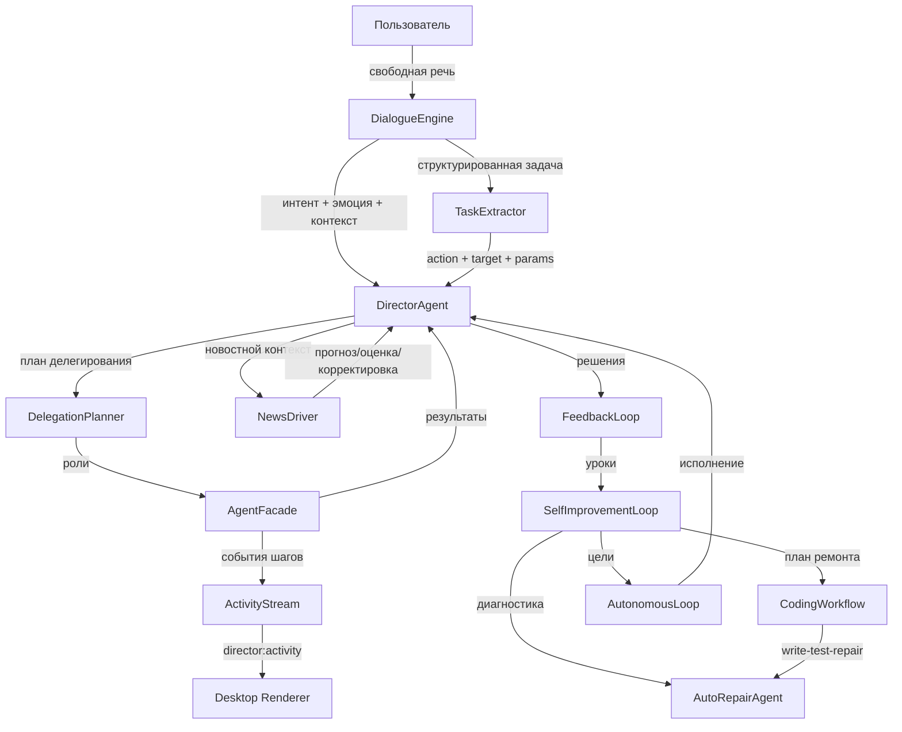
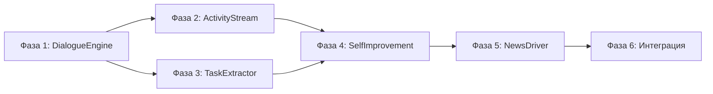

# План эволюции Директора и агентов finance-analyzer

> Цель: +200–300% к текущему уровню по интеграции, UX, автономности и качеству решений.
> Документ — результат Фазы 0 (анализ кода). Порядок работ: Фазы 1..6, каждая с тестами (`vitest`), `npx tsc --noEmit`, `eslint`.

---

## 1. Итоги анализа текущего состояния (Фаза 0)

### 1.1 Что уже реализовано (проверено по коду)

| Модуль                    | Файл                                                                                                                                           | Состояние                                                                                                                                                |
| ------------------------- | ---------------------------------------------------------------------------------------------------------------------------------------------- | -------------------------------------------------------------------------------------------------------------------------------------------------------- |
| `BrowserDirector`         | [`browser-director.ts`](../src/js/modules/pipeline/director/browser-director.ts)                                                               | Жёсткие regex-ветки: приветствие, «как дела», оффтопик, поправки, отчёты (строки 226–305). LLM-синтез через Ollama есть, но маршрутизация — по шаблонам. |
| `DirectorAgent`           | [`director.ts`](../src/js/modules/pipeline/director/director.ts)                                                                               | Уже использует `chatResponder` (LLM) для свободного диалога и `goalIntake` для задач. Regex-ветки остались для greeting/offtopic/simple-chat/status.     |
| NL-парсер                 | [`nl-parser.ts`](../src/js/modules/pipeline/director/nl-parser.ts)                                                                             | Словари ключевых слов + regex: категории, интенции, тикеры, файловые/терминальные/кодовые запросы. Работает, но не «понимает» свободную речь.            |
| Планировщик делегирования | [`delegation-planner.ts`](../src/js/modules/pipeline/director/delegation-planner.ts)                                                           | Выбор агентов по категории/интенции, обоснования ролей, Consilium-флаги.                                                                                 |
| Фасад агентов             | [`agent-facade.ts`](../src/js/modules/pipeline/director/agent-facade.ts)                                                                       | Запуск ролей параллельно, security-gate для action-агентов, детерминированные исполнители ai/review.                                                     |
| Построитель входов        | [`action-input-builder.ts`](../src/js/modules/pipeline/director/action-input-builder.ts)                                                       | Парсинг запроса → вход FileAgent/TerminalAgent/PackageAgent/ProcessAgent/AutomationAgent/CodingWorkflow.                                                 |
| Автономный цикл           | [`autonomous-loop.ts`](../src/js/modules/pipeline/autonomous-loop/autonomous-loop.ts)                                                          | Цели → исполнитель → FeedbackLoop → урок. Лимиты, forbiddenRoles, dry-run.                                                                               |
| CodingWorkflow            | [`coding-workflow.ts`](../src/js/modules/pipeline/coding-workflow/coding-workflow.ts)                                                          | write → test → analyze → repair → retest → report.                                                                                                       |
| MetaOrchestrator          | [`meta-orchestrator.ts`](../src/js/modules/pipeline/meta-orchestrator/meta-orchestrator.ts)                                                    | Динамический выбор агентов, retry, мониторинг.                                                                                                           |
| FeedbackLoop              | [`feedback-loop.ts`](../src/js/modules/pipeline/feedback-loop/feedback-loop.ts)                                                                | OutcomeTracker + SuccessMetrics + ABTestEngine + ReinforcementLearning.                                                                                  |
| PredictionEngine          | [`prediction-engine.ts`](../src/js/modules/pipeline/prediction-engine/prediction-engine.ts)                                                    | forecast / predict-needs / detect-anomalies / analyze-trend / plan-scenarios / full-report.                                                              |
| Gatekeeper + NewsCache    | [`gatekeeper.ts`](../src/js/modules/pipeline/gatekeeper/gatekeeper.ts), [`news-cache.ts`](../src/js/modules/pipeline/gatekeeper/news-cache.ts) | Сбор/фильтрация/дедупликация новостей, тренды по тикерам, сентимент.                                                                                     |
| AI Memory                 | [`core.ts`](../src/js/modules/pipeline/ai-memory/core.ts)                                                                                      | Оперативная + стратегическая память (SQLite), vector-search, KPI-снимки.                                                                                 |
| LearningAgent             | [`learning-agent.ts`](../src/js/modules/pipeline/agents/learning-agent.ts)                                                                     | Анализ истории, уроки, эвристическое предсказание, рекомендации.                                                                                         |
| AutoRepairAgent           | [`auto-repair-agent.ts`](../src/js/modules/pipeline/agents/auto-repair-agent.ts)                                                               | Диагностика deps/configs/integrity/history + безопасный авто-ремонт.                                                                                     |
| Desktop                   | [`main.ts`](../desktop/main.ts), [`ipc-core.ts`](../desktop/ipc-core.ts), [`renderer/app.ts`](../desktop/renderer/app.ts)                      | Electron: вкладки Чат/Агенты/Консоль/Диспетчер/Анализ/Цели. Аудит-стрим `director:event` уже работает. `AutonomousBridge` + `goalIntake` подключены.     |
| Аудит                     | [`director-audit.ts`](../src/js/modules/pipeline/director/director-audit.ts)                                                                   | `onEvent()` — живой стрим событий в renderer.                                                                                                            |
| Consilium                 | [`multi-round-consilium.ts`](../src/js/modules/pipeline/director/multi-round-consilium.ts)                                                     | Многораундовые дебаты, tie-break AI.                                                                                                                     |

### 1.2 Ключевые проблемы (из задачи + подтверждены кодом)

1. **Regex-маршрутизация вместо диалога.** `BrowserDirector.processUserMessage()` (строки 226–305) и частично `DirectorAgent` используют жёсткие regex для приветствий/оффтопика/поправок/отчётов. Это не «разговор двух людей».
2. **Работа агентов видна фрагментарно.** Аудит-стрим и вкладка «Агенты» показывают события, но не живые шаги агентов в диалоге (что делает агент прямо сейчас, какие шаги, что получил).
3. **Извлечение задач ограничено.** `nl-parser.ts` + `looksLikeTaskIntent` — только паттерны. Нет LLM-извлечения структурированных задач из свободной речи.
4. **Самоулучшение не замкнуто.** `coding-workflow`, `auto-repair`, `learning`, `autonomous-loop` существуют отдельно, но нет единого цикла «Директор диагностирует → правит свой код и код агентов → тестирует → учится на результатах».
5. **Новости не активный драйвер.** `NewsCache` и `analyzeNewsForTicker()` есть, но новости не влияют на прогноз/оценку/корректировку стратегии в конвейере Director.

---

## 2. Целевая архитектура

### 2.1 Новые модули (все в `src/js/modules/pipeline/`)

| Модуль              | Назначение                                                                                           | Ключевые файлы                                                                                        |
| ------------------- | ---------------------------------------------------------------------------------------------------- | ----------------------------------------------------------------------------------------------------- |
| `dialogue-engine/`  | Естественный диалог: LLM-классификация интентов, эмоции, контекст follow-up, fallback на `nl-parser` | `types.ts`, `dialogue-engine.ts`, `intent-classifier.ts`, `context-tracker.ts`, `emotion-detector.ts` |
| `agent-activity/`   | Стриминг шагов агентов в реальном времени                                                            | `types.ts`, `activity-stream.ts`, `activity-renderer.ts`                                              |
| `task-extractor/`   | LLM-извлечение структурированных задач из свободной речи                                             | `types.ts`, `task-extractor.ts`, `action-resolver.ts`                                                 |
| `self-improvement/` | Замкнутый цикл самоулучшения: диагностика → план → coding-workflow → тесты → уроки                   | `types.ts`, `self-improvement-loop.ts`, `repair-planner.ts`, `improvement-goals.ts`                   |
| `news-driver/`      | Новости как активный драйвер прогноза/оценки/корректировки стратегии                                 | `types.ts`, `news-driver.ts`, `news-impact-scorer.ts`, `news-strategy-adapter.ts`                     |

### 2.2 Изменяемые существующие модули

| Файл                                                                                  | Изменение                                                                                                                                                     |
| ------------------------------------------------------------------------------------- | ------------------------------------------------------------------------------------------------------------------------------------------------------------- |
| [`browser-director.ts`](../src/js/modules/pipeline/director/browser-director.ts)      | Заменить regex-ветки на `DialogueEngine`; подключить `ActivityStream`; новостной контекст через `NewsDriver`.                                                 |
| [`director.ts`](../src/js/modules/pipeline/director/director.ts)                      | Подключить `DialogueEngine` (классификация), `TaskExtractor` (до `parseUserMessage`), `NewsDriver` (в `buildLlmContext`), `ActivityStream` (в делегирование). |
| [`agent-facade.ts`](../src/js/modules/pipeline/director/agent-facade.ts)              | Emit событий `agent.started` / `agent.step` / `agent.completed` / `agent.failed` через `ActivityStream`.                                                      |
| [`coding-workflow.ts`](../src/js/modules/pipeline/coding-workflow/coding-workflow.ts) | Emit шагов write/test/analyze/repair/retest/report через `ActivityStream`.                                                                                    |
| [`delegation-planner.ts`](../src/js/modules/pipeline/director/delegation-planner.ts)  | Поддержка задач из `TaskExtractor` (не только категорий).                                                                                                     |
| [`nl-parser.ts`](../src/js/modules/pipeline/director/nl-parser.ts)                    | Паттерны для self-improvement; остаётся как fallback.                                                                                                         |
| [`agent-factory.ts`](../src/js/modules/pipeline/agents/agent-factory.ts)              | Регистрация `self-improvement` роли.                                                                                                                          |
| [`ipc-core.ts`](../desktop/ipc-core.ts)                                               | Новый канал `director:activity`; подключение `NewsDriver` к фактам.                                                                                           |
| [`renderer/app.ts`](../desktop/renderer/app.ts)                                       | Отображение живых шагов агентов в чате; новостной блок.                                                                                                       |
| [`autonomous-bridge.ts`](../desktop/autonomous-bridge.ts)                             | Роль `self-improve` в цикле.                                                                                                                                  |

---

## 3. Фазы реализации

### Фаза 1 — Естественный диалог (NLU вместо regex-заглушек)

**Цель:** общение Директора с пользователем как разговор двух людей: понимание свободной речи, контекста, follow-up, эмоций; без regex-заглушек.

**Новые файлы:**

- `dialogue-engine/types.ts` — `DialogueIntent` (greeting, status, off-topic, correction, report, portfolio, asset, scenario, strategy, task, action, smalltalk, unknown), `DialogueEmotion` (positive/negative/neutral/urgent), `DialogueContext` (lastTickers, lastTopic, followUp), `DialogueAnalysis` (intent, emotion, tickers, entities, confidence, needsAgents).
- `dialogue-engine/intent-classifier.ts` — LLM-классификатор через `OllamaClient` (JSON-схема ответа), детерминированный fallback на `nl-parser` при недоступности LLM. DI: `classify(text, context) → DialogueAnalysis`.
- `dialogue-engine/context-tracker.ts` — хранение контекста диалога: последние тикеры, тема, follow-up-связки («а если», «а что», «дальше»), анафоры («он», «эта акция»).
- `dialogue-engine/emotion-detector.ts` — определение эмоций по лексике + LLM-уточнение (опционально).
- `dialogue-engine/dialogue-engine.ts` — фасад: `analyze(text, history) → DialogueAnalysis`; `respond(analysis, facts) → string | null` (для smalltalk/off-topic без агентов).

**Изменения:**

- [`browser-director.ts`](../src/js/modules/pipeline/director/browser-director.ts): заменить блоки строк 226–305 на `DialogueEngine.analyze()`; ветки greeting/status/off-topic/correction/report — по `DialogueAnalysis.intent`, а не по regex.
- [`director.ts`](../src/js/modules/pipeline/director/director.ts): заменить `looksLikeGreeting`/`looksLikeOffTopic`/`looksLikeSimpleChat`/`looksLikeStatusQuestion` на `DialogueEngine` (с сохранением fallback для тестов без LLM).

**Критерии готовности:**

- `BrowserDirector` отвечает на «привет», «как дела», «что нового», «спасибо», «а если сокращу PLZL?» без regex-веток (через DialogueEngine).
- Follow-up «а если…» без тикера подтягивает контекст из `ContextTracker`.
- Эмоции определяются и влияют на тон ответа (например, тревога → успокаивающий тон).
- Все существующие тесты `director.test.ts`, `browser-director` (если есть), `nl-parser.test.ts` проходят.

**Тесты:** `dialogue-engine/dialogue-engine.test.ts`, `intent-classifier.test.ts`, `context-tracker.test.ts`, `emotion-detector.test.ts`; обновление `director.test.ts`.

---

### Фаза 2 — Видимая работа агентов в реальном времени

**Цель:** пользователь в реальном времени видит, какие агенты запущены, что делают, какие шаги выполняют, что получили.

**Новые файлы:**

- `agent-activity/types.ts` — `AgentActivityEvent` (id, taskId, role, phase: 'started'|'step'|'completed'|'failed', message, detail, timestamp, durationMs), `ActivitySubscriber`.
- `agent-activity/activity-stream.ts` — EventEmitter-стрим: `emit(event)`, `subscribe(fn)`, `unsubscribe(fn)`, буфер последних N событий.
- `agent-activity/activity-renderer.ts` — чистая функция форматирования события в строку чата («🔍 ResearchAgent: собираю факты по SBER…», «✅ AnalysisAgent: готово за 120 мс»).

**Изменения:**

- [`agent-facade.ts`](../src/js/modules/pipeline/director/agent-facade.ts): в `executeRoles()` — emit `started` перед запуском роли, `completed`/`failed` после; в `executeRole()` — emit `step` для фаз (например, security-gate → выполнение).
- [`coding-workflow.ts`](../src/js/modules/pipeline/coding-workflow/coding-workflow.ts): emit шагов write/test/analyze/repair/retest/report.
- [`director.ts`](../src/js/modules/pipeline/director/director.ts): подключить `ActivityStream` (DI), пробрасывать в `DirectorResponse` (поле `activity?: AgentActivityEvent[]`).
- [`ipc-core.ts`](../desktop/ipc-core.ts): канал `director:activity` (подписка на стрим → `sendToRenderer`).
- [`renderer/app.ts`](../desktop/renderer/app.ts): отображение событий активности в чате (блок «🤖 Агенты работают: …»), обновление вкладки «Агенты» в реальном времени.

**Критерии готовности:**

- При вопросе «Что с SBER?» в чате видны живые шаги: ResearchAgent стартовал → собирает факты → готов; AnalysisAgent → готов; AI Agent → формирует мнение.
- CodingWorkflow показывает write → test → repair → retest в реальном времени.
- События активности не ломают существующий аудит-стрим.

**Тесты:** `agent-activity/activity-stream.test.ts`, `activity-renderer.test.ts`; обновление `agent-facade`-тестов, `coding-workflow.test.ts`.

---

### Фаза 3 — Извлечение задач из свободной речи

**Цель:** Директор находит задачи в свободной речи и привлекает нужных агентов (не только портфельных — file/terminal/code/browser/...).

**Новые файлы:**

- `task-extractor/types.ts` — `ExtractedTask` (id, action: 'file'|'terminal'|'code'|'package'|'process'|'automation'|'research'|'portfolio'|'goal', target, params, confidence, rawText), `TaskExtractionResult`.
- `task-extractor/task-extractor.ts` — LLM-извлечение через `OllamaClient` (JSON-схема: `{tasks: [{action, target, params}]}`), fallback на `nl-parser` + `action-input-builder` при недоступности LLM.
- `task-extractor/action-resolver.ts` — маппинг извлечённой задачи на `AgentRole[]` + вход для `action-input-builder`.

**Изменения:**

- [`director.ts`](../src/js/modules/pipeline/director/director.ts): перед `parseUserMessage` — `TaskExtractor.extract(message)`; если найдена задача с confidence ≥ порога — строить план напрямую (минуя категорийную маршрутизацию).
- [`delegation-planner.ts`](../src/js/modules/pipeline/director/delegation-planner.ts): метод `buildPlanFromTask(task: ExtractedTask)`.
- [`nl-parser.ts`](../src/js/modules/pipeline/director/nl-parser.ts): остаётся fallback'ом.

**Критерии готовности:**

- «Создай файл src/test.ts с тестом» → FileAgent (write) с путём `src/test.ts`.
- «Запусти тесты и покажи результат» → TerminalAgent (`npm run test`).
- «Реализуй функцию в src/js/modules/x/y.ts» → CodingWorkflow.
- «Добавь в план: покрыть модуль тестами» → GoalAgent (цель автономного цикла).
- Без LLM — работает fallback на существующие парсеры.

**Тесты:** `task-extractor/task-extractor.test.ts`, `action-resolver.test.ts`; обновление `director.test.ts`, `delegation-planner.test.ts`.

---

### Фаза 4 — Управление компьютером + самоулучшение

**Цель:** Директор через агентов (file/terminal/security/coding-workflow/auto-repair/learning) правит свой код и код агентов, улучшает функционал, обучается на результатах (feedback-loop).

**Новые файлы:**

- `self-improvement/types.ts` — `ImprovementPlan` (id, goal, diagnosis, steps: Array<{role, input}>, expectedOutcome), `ImprovementResult` (success, testPassed, repairIterations, lessons, metrics).
- `self-improvement/repair-planner.ts` — планирование ремонта: вход — диагностика `AutoRepairAgent` + уроки `LearningAgent` + метрики `FeedbackLoop`; выход — план шагов (file/terminal/code).
- `self-improvement/improvement-goals.ts` — генерация целей улучшения из слабых категорий `FeedbackLoop.analyze()` (win rate < 0.4 → цель «пересмотреть подход к категории X»).
- `self-improvement/self-improvement-loop.ts` — замкнутый цикл: `diagnose (AutoRepairAgent) → plan (RepairPlanner) → execute (CodingWorkflow + FileAgent/TerminalAgent через security-gate) → verify (npm test / tsc) → learn (FeedbackLoop.record-outcome + LearningAgent.feedback) → report`.

**Изменения:**

- [`agent-factory.ts`](../src/js/modules/pipeline/agents/agent-factory.ts): регистрация роли `self-improve` (lazy-создание `SelfImprovementLoop`).
- [`nl-parser.ts`](../src/js/modules/pipeline/director/nl-parser.ts): паттерны `SELF_IMPROVEMENT_REQUEST_PATTERNS` («почини проект», «исправь ошибки», «улучши систему», «проверь здоровье проекта»).
- [`delegation-planner.ts`](../src/js/modules/pipeline/director/delegation-planner.ts): роль `self-improve` + обоснование.
- [`autonomous-bridge.ts`](../desktop/autonomous-bridge.ts): роль `self-improve` в `FORBIDDEN_ROLES`-контроле (разрешена, но с security-gate).
- [`director-types.ts`](../src/js/modules/pipeline/director/director-types.ts): `AgentRole` += `'self-improve'`.

**Критерии готовности:**

- «Проверь здоровье проекта» → AutoRepairAgent.diagnose → отчёт в чат.
- «Почини проект» → SelfImprovementLoop: diagnose → plan → coding-workflow → verify → урок в FeedbackLoop.
- Все операции проходят SecurityAgent (allow/deny/require-confirmation).
- Результат ремонта записывается в FeedbackLoop (решение → результат → награда).

**Тесты:** `self-improvement/self-improvement-loop.test.ts`, `repair-planner.test.ts`, `improvement-goals.test.ts`; обновление `agent-factory.test.ts`, `nl-parser.test.ts`.

---

### Фаза 5 — Новости как драйвер

**Цель:** агенты и Директор используют новости для прогноза, оценки и корректировки инвестиционной стратегии.

**Новые файлы:**

- `news-driver/types.ts` — `NewsImpact` (ticker, sentimentScore, importance, impactDirection: 'positive'|'negative'|'neutral', affectedMetrics: string[], suggestedAction: AiAction | null), `NewsDriverContext`.
- `news-driver/news-impact-scorer.ts` — оценка влияния новости на актив: сентимент × важность × релевантность тикера → impact score.
- `news-driver/news-strategy-adapter.ts` — корректировка стратегии: если по тикеру критический негатив → рекомендация пересмотреть позицию; позитив → усилить тезис.
- `news-driver/news-driver.ts` — фасад: `analyzePortfolio(facts, newsCache) → NewsImpact[]`; `buildNewsContext(impacts) → string` (для LLM-контекста); `adjustRecommendation(rec, impacts) → rec`.

**Изменения:**

- [`director.ts`](../src/js/modules/pipeline/director/director.ts): в `buildLlmContext` — добавлять `NewsDriver.buildNewsContext()`; в `buildReply` — упоминать новостные драйверы.
- [`agent-facade.ts`](../src/js/modules/pipeline/director/agent-facade.ts): роль `research` — использовать `NewsDriver` для сводки; роль `ai` — передавать новостные impact'ы в контекст.
- [`prediction-engine.ts`](../src/js/modules/pipeline/prediction-engine/prediction-engine.ts): опциональный вход `newsImpacts` для `plan-scenarios` (сценарии с учётом новостного фона).
- [`browser-director.ts`](../src/js/modules/pipeline/director/browser-director.ts): `analyzeNewsForTicker()` — переиспользовать `NewsDriver`.

**Критерии готовности:**

- «Что нового по SBER?» → ответ включает сентимент, важность, влияние на позицию.
- Критическая новость по тикеру меняет рекомендацию (например, HOLD → REDUCE с обоснованием).
- Новостной контекст попадает в LLM-промпт и в сценарии PredictionEngine.

**Тесты:** `news-driver/news-driver.test.ts`, `news-impact-scorer.test.ts`, `news-strategy-adapter.test.ts`; обновление `agent-facade.test.ts`, `prediction-engine.test.ts`.

---

### Фаза 6 — Интеграция, тесты, документация

**Цель:** целостный Директор, все фазы работают вместе, 1000+ существующих тестов не сломаны.

**Работы:**

1. Сквозная интеграция: `DialogueEngine → TaskExtractor → DelegationPlanner → AgentFacade (+ActivityStream) → NewsDriver → FeedbackLoop → SelfImprovementLoop`.
2. Обновление [`ARCHITECTURE.md`](../ARCHITECTURE.md) и [`AI-AGENT-PLAN.md`](../AI-AGENT-PLAN.md): новые модули, диаграммы, контракты.
3. Обновление `desktop/` (renderer + ipc-core): вкладка «Агенты» показывает живые шаги; вкладка «Чат» — новостной блок.
4. Полный прогон: `npm test` (все тесты), `npx tsc --noEmit`, `eslint`.
5. Smoke-тесты: `scripts/director-chat-smoke.test.ts`, `desktop/ipc-core.test.ts`, `desktop/autonomous-bridge.test.ts`.

**Критерии готовности:**

- Все новые модули покрыты тестами (≥ 80% ключевых веток).
- Существующие тесты не сломаны (1000+).
- `npx tsc --noEmit` и `eslint` без ошибок.
- Документация обновлена.

---

## 4. Порядок работ и зависимости

- Фазы 1–3 независимы по модулям, но Фаза 2 использует `agent-facade` (общий), поэтому порядок: 1 → 2 → 3 → 4 → 5 → 6.
- Каждая фаза завершается: тесты → `tsc --noEmit` → `eslint` → коммит.

---

## 5. Критерии готовности проекта (итог)

1. **Естественный диалог:** Директор понимает свободную речь, follow-up, эмоции; regex-ветки в `BrowserDirector` заменены на `DialogueEngine`.
2. **Видимая работа агентов:** живые шаги агентов в чате (ActivityStream → renderer).
3. **Извлечение задач:** задачи из свободной речи → нужные агенты (file/terminal/code/...).
4. **Самоулучшение:** замкнутый цикл diagnose → plan → code → verify → learn.
5. **Новости как драйвер:** новости влияют на прогноз, оценку, корректировку стратегии.
6. **Качество:** 1000+ тестов зелёные, `tsc --noEmit` и `eslint` чистые, документация обновлена.

---

## 6. Риски и меры

| Риск                                          | Мера                                                                                                               |
| --------------------------------------------- | ------------------------------------------------------------------------------------------------------------------ |
| LLM недоступен (Ollama выключен)              | Все новые модули имеют детерминированный fallback на существующие парсеры/исполнители.                             |
| Слом существующих 1000+ тестов                | Каждая фаза — отдельный прогон тестов; изменения в `director.ts`/`agent-facade.ts` — минимальные, через DI.        |
| `as any` / нестрогий TS                       | Строгий TypeScript, типы в `types.ts` каждого модуля; `tsc --noEmit` в CI каждой фазы.                             |
| Безопасность (self-improvement правит код)    | Все операции через SecurityAgent (allow/deny/require-confirmation); forbiddenRoles в автономном цикле.             |
| Стриминг событий перегружает UI               | Буфер ActivityStream (последние N), лимит строк в renderer, батчинг событий.                                       |
| Новости устарели/шумные                       | NewsCache TTL, приоритизация (critical/high), порог релевантности.                                                 |
| Регрессия браузерной сборки (BrowserDirector) | Модули `dialogue-engine`/`agent-activity` — без Node-зависимостей (как `action-input-builder`), type-only импорты. |

---

## 7. Конвенции (обязательны при реализации)

- TypeScript ESM, строгий режим, без `as any` (допустимы только типизированные касты через `unknown`).
- DI для всех зависимостей (тесты не трогают реальные БД/сеть).
- Каждое изменение — с тестами (`vitest`).
- Безопасность: все операции с компьютером — через SecurityAgent.
- Файлы новых модулей — в `src/js/modules/pipeline/<module>/` с `index.ts`-экспортом.
- Документировать архитектурные решения в JSDoc-шапках файлов.

---

## 8. Статус выполнения (обновлено при завершении Фазы 6)

### 8.1 Фазы 1–5 — завершены ✅

| Фаза                       | Модуль                                                                         | Статус                                                                                                                      | Проверка                                                                                                            |
| -------------------------- | ------------------------------------------------------------------------------ | --------------------------------------------------------------------------------------------------------------------------- | ------------------------------------------------------------------------------------------------------------------- |
| 1 — Естественный диалог    | `dialogue-engine/` (intent-classifier, context-tracker, emotion-detector)      | ✅ Подключён в `DirectorAgent`/`BrowserDirector`; regex-ветки заменены                                                      | `dialogue-engine.test.ts`, `intent-classifier.test.ts`, `context-tracker.test.ts`, `emotion-detector.test.ts`       |
| 2 — Видимая работа агентов | `agent-activity/` (activity-stream, activity-renderer)                         | ✅ `AgentFacade` эмитит `started/step/completed/failed`; канал `director:activity` в desktop; `DirectorResponse.activity`   | `activity-stream.test.ts`, `activity-renderer.test.ts`, `ipc-core.test.ts` (22), `director.test.ts` (34)            |
| 3 — Извлечение задач       | `task-extractor/` (task-extractor, action-resolver)                            | ✅ LLM + fallback; `buildPlanFromTask` в планировщике; прямое планирование при `confidence ≥ 0.7`                           | `task-extractor.test.ts`, `action-resolver.test.ts`, `delegation-planner.test.ts` (11)                              |
| 4 — Самоулучшение          | `self-improvement/` (self-improvement-loop, repair-planner, improvement-goals) | ✅ Цикл diagnose → plan → execute → verify → learn; роль `self-improve` в фабрике; SecurityAgent-контроль                   | `self-improvement-loop.test.ts`, `repair-planner.test.ts`, `improvement-goals.test.ts`, `agent-factory.test.ts` (8) |
| 5 — Новости как драйвер    | `news-driver/` (news-driver, news-impact-scorer, news-strategy-adapter)        | ✅ `NewsImpact`/`analyzePortfolio`/`buildNewsContext`/`adjustRecommendation`; роли research/ai в фасаде; `browser-director` | `news-driver.test.ts`, `news-impact-scorer.test.ts`, `news-strategy-adapter.test.ts`                                |

### 8.2 Фаза 6 — интеграция, тесты, документация ✅

1. **Сквозная интеграция:** единый поток `DialogueEngine → TaskExtractor → DelegationPlanner → AgentFacade (+ActivityStream) → NewsDriver → FeedbackLoop → SelfImprovementLoop` работает без дублирования логики и конфликтов DI (импорты и DI-опции в `director.ts`, `agent-facade.ts`, `agent-factory.ts`, `autonomous-loop.ts`, `desktop/ipc-core.ts`).
2. **Документация:** [`ARCHITECTURE.md`](../ARCHITECTURE.md) (новые модули в §3.5, §5.2, поток и контракты, диаграмма §8) и [`AI-AGENT-PLAN.md`](../AI-AGENT-PLAN.md) (раздел «✅ Уже сделано» — Директор-эволюция и desktop-интеграция) обновлены.
3. **Desktop:** вкладка «Агенты» показывает живые шаги (ActivityStream → `director:activity`); вкладка «Чат» — новостной блок (NewsDriver подключён в `ipc-core.ts` через пустой `NewsCacheLike`-контракт, `AskResult.news` → `appendNewsBlock` в рендерере); `DirectorResponse.news` фиксирует контракт.
4. **Полный прогон:** `npm run test:run` — **132/134 файла ✅, 2242 passed / 10 skipped**; упал 1 известный сетевой флейк `xlsx-parser` (`syncNewTrades`, таймаут 5 с под параллельными workers). **В изоляции зелёные:** `xlsx-parser.test.ts` (68/68), `backtesting.test.ts` (6/6, MOEX ISS), `moex-quote-provider.test.ts` (7/7). `npx tsc --noEmit` ✅, `tsc -p desktop/tsconfig.json --noEmit` ✅, `npx eslint src desktop scripts *.js gulp` ✅.
5. **Smoke-тесты:** `scripts/director-chat-smoke.test.ts` (1) ✅, `desktop/ipc-core.test.ts` (22) ✅, `desktop/autonomous-bridge.test.ts` (7) ✅.
6. **Критерии готовности** (см. §5): естественный диалог ✅ · видимая работа агентов ✅ · извлечение задач ✅ · самоулучшение ✅ · новости как драйвер ✅ · качество (тесты/tsc/eslint/документация) ✅.

> Примечание: полный `npx eslint .` (без явных путей) на этой машине захватывает изолированные worktree'ы `.gigacode_vsc/` — это артефакт окружения, а не кода; гранулированный запуск по `src desktop scripts *.js gulp` (как в npm-скриптах) — чисто.
